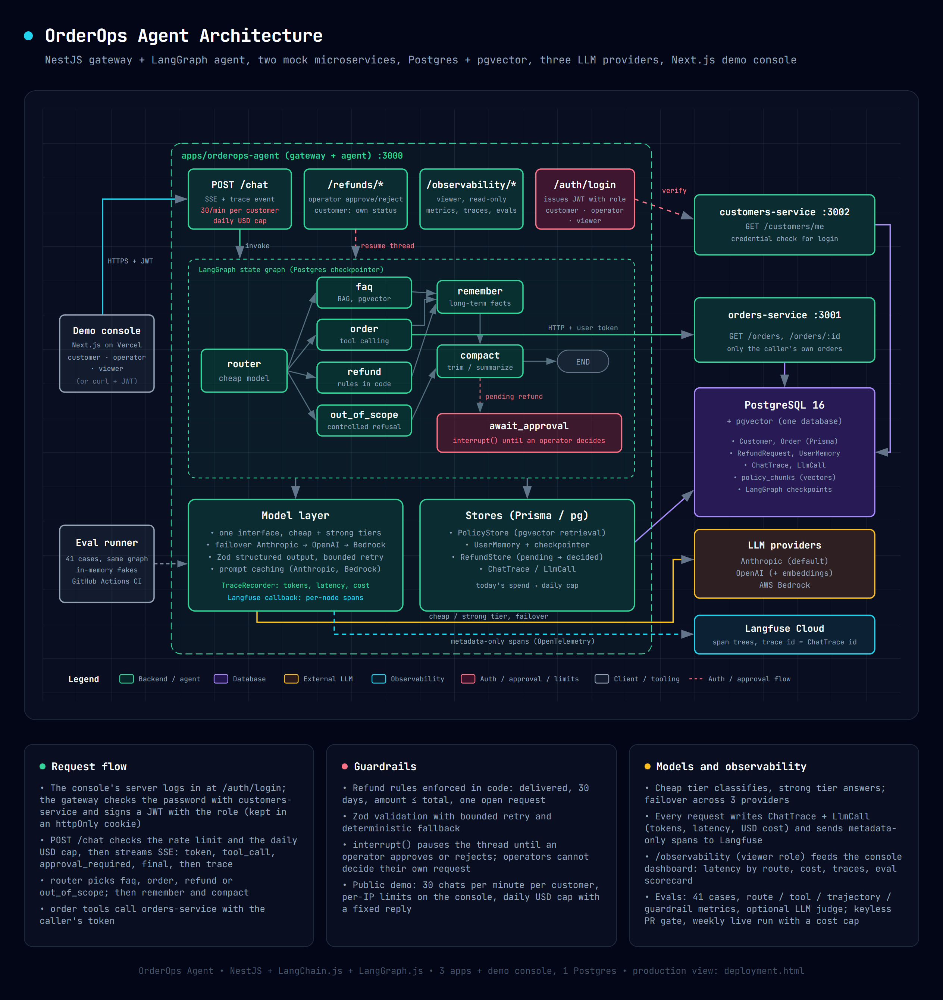

# OrderOps Agent

A support and operations agent for a fictional e-commerce store, built with
NestJS, LangChain.js and LangGraph.js. It is a guided learning and portfolio
project for production agentic patterns: state-graph orchestration, tool calling
against authenticated microservices, memory, guardrails, multiple model
providers, observability and evals.

A customer logs in, chats with the agent over SSE, and the agent can:

- look up the customer's own orders (tool calls to `orders-service` with the
  customer's token),
- answer store-policy questions (RAG over `apps/orderops-agent/policies/*.md`
  in pgvector),
- refuse anything out of scope,
- remember the conversation across turns and facts about the user across threads,
- take refund requests, enforce the refund rules in code, and pause the thread
  until a human operator approves or rejects.

Every chat request is traced (route, tools, tokens, latency, estimated cost) and
the agent is regression-tested with a 41-case eval suite.



The diagram source is [docs/architecture.html](docs/architecture.html)
(PDF: [docs/architecture.pdf](docs/architecture.pdf)).

## Architecture at a glance

Three NestJS apps in one monorepo, all backed by one Postgres database:

| App                        | Port | Role                                                                   |
| -------------------------- | ---- | ---------------------------------------------------------------------- |
| `orderops-agent` (gateway) | 3000 | Login, SSE chat, the LangGraph agent, operator refund endpoints        |
| `orders-service`           | 3001 | Mock orders API; returns only the caller's own orders                  |
| `customers-service`        | 3002 | Mock customers API; verifies credentials, returns the caller's profile |

The agent graph routes each message to one of four routes: `faq`, `order`,
`refund` or `out_of_scope`. A cheap model classifies and a strong model answers.
Chat models fail over Anthropic, then OpenAI, then AWS Bedrock (Bedrock only
when `AWS_REGION` is set). OpenAI also provides the embeddings for the FAQ index.

## Prerequisites

- Node.js 22 and npm
- Docker (Postgres 16 with pgvector runs in a container)
- An Anthropic API key and an OpenAI API key (both are required at startup)
- Optional: AWS credentials and region for the Bedrock failover

> **Install note.** The npm bundled with Node 22.18 (10.9.3) crashes on this
> project's install (an arborist `edgesOut` bug). Use npm 11 through npx:
> `npx -y npm@11 install`.

## Setup

Run everything from the repository root.

1. **Install dependencies**

   ```bash
   npx -y npm@11 install
   ```

2. **Create `.env`**

   ```bash
   cp .env.example .env        # PowerShell: Copy-Item .env.example .env
   ```

   Then set at least:

   - `JWT_SECRET`: any string of 32+ characters, shared by all apps
   - `ANTHROPIC_API_KEY` and `OPENAI_API_KEY`
   - optional `AWS_REGION` (plus keys, or the AWS default credential chain) to
     enable the Bedrock failover

   Every app validates its environment at startup and exits with a clear error
   when something is missing. The default `DATABASE_URL` already matches the
   Docker database below.

3. **Start Postgres**

   ```bash
   docker compose up -d
   ```

   Wait until `docker ps` shows `orderops-postgres` as `healthy`. It listens on
   `localhost:5432`.

4. **Create the tables**

   ```bash
   npx prisma migrate deploy
   npx prisma generate
   ```

   Use `migrate deploy`, not `migrate dev`. `migrate dev` reports drift from the
   library-managed tables (`policy_chunks` and the LangGraph checkpoint tables)
   and offers to reset the database. Do not accept that.

5. **Seed the data** (idempotent)

   ```bash
   npx prisma db seed
   ```

   Expected: `Seeded 4 customers and 7 orders`. The users and orders are listed
   in [Seed data](#seed-data).

6. **Index the policy documents** (needed by the FAQ route)

   ```bash
   npm run ingest:policies
   ```

   Expected: `Ingested 14 policy chunks`. It replaces the whole index, so
   rerunning is safe.

## Run

Start all three apps in watch mode, with prefixed output (Ctrl+C stops them all):

```bash
npm run start:all
```

Or one at a time, in three terminals:

```bash
npm run start:dev                              # gateway, :3000
npm run start:dev -- orders-service            # :3001
npm run start:dev -- customers-service         # :3002
```

Each app logs `Nest application successfully started` when it is ready. If the
gateway fails with `EADDRINUSE` on port 3000, something else is using it; see
[Troubleshooting](#troubleshooting).

For a production-style run of the gateway: `npm run build && npm run start:prod`.

## Try the whole system by hand

The examples use `curl` in a Bash-style shell (Git Bash, WSL, macOS, Linux). They
assume the gateway is on `localhost:3000`; replace the port if you changed it.
On Windows PowerShell use `curl.exe` (not the `curl` alias) and write JSON bodies
to a file or use single-quoted strings with escaped quotes.

SSE responses stream `token` events as the answer is written. The examples below
show only the other events to keep them short. Add `-N` to `curl` to see the
stream live.

### 1. Log in

```bash
curl -s -X POST localhost:3000/auth/login \
  -H 'content-type: application/json' \
  -d '{"email":"ana@example.com","password":"orderops-dev-password"}'
```

Expected: `{"accessToken":"eyJ...","tokenType":"Bearer","expiresIn":3600}`. Keep the
token in a variable for the next steps:

```bash
TOKEN=<paste accessToken here>
```

A wrong password returns `401 {"message":"Invalid credentials",...}`.

### 2. Call the mock services directly

The same token works on the services. They return only the caller's own data:

```bash
curl -s localhost:3001/orders          -H "Authorization: Bearer $TOKEN"   # Ana's 3 orders
curl -s localhost:3002/customers/me    -H "Authorization: Bearer $TOKEN"   # {"id":"cus_ana",...,"tier":"premium"}
curl -s localhost:3001/orders/ORD-2001 -H "Authorization: Bearer $TOKEN"   # 404: it belongs to Ben
curl -s localhost:3001/orders                                              # 401: no token
```

### 3. Order lookup

```bash
curl -sN -X POST localhost:3000/chat \
  -H "Authorization: Bearer $TOKEN" -H 'content-type: application/json' \
  -d '{"message":"Where is my order ORD-1002?"}'
```

Expected events, in order:

```text
event: tool_call
data: {"name":"get_order","args":{"orderId":"ORD-1002"}}

event: token
data: {"text":"Order "}
... more token events ...

event: final
data: {"answer":"Order ORD-1002 has shipped! ...","orderIds":["ORD-1002"],"route":"order","threadId":"<uuid>"}
```

The exact wording varies; the tool call, `route: "order"` and the `orderIds` do not.
Other event types: `approval_required` (refund waiting for an operator) and
`error` (`agent_error` or `invalid_output`, with a generic message).

### 4. Store policy question (FAQ)

```bash
curl -sN -X POST localhost:3000/chat -H "Authorization: Bearer $TOKEN" \
  -H 'content-type: application/json' \
  -d '{"message":"What is your return policy?"}'
```

Expected: no `tool_call`; `final` has `"route":"faq"` and an answer drawn from
`policies/returns.md` (30-day window, refund within 5 business days, ...).

### 5. Out-of-scope refusal

```bash
curl -sN -X POST localhost:3000/chat -H "Authorization: Bearer $TOKEN" \
  -H 'content-type: application/json' \
  -d '{"message":"Write me a poem about the ocean"}'
```

Expected: `"route":"out_of_scope"` and a fixed refusal that points back to orders
and store policies.

### 6. Memory across turns

The `final` event carries a `threadId`. Send it back to continue the same
conversation:

```bash
curl -sN -X POST localhost:3000/chat -H "Authorization: Bearer $TOKEN" \
  -H 'content-type: application/json' \
  -d '{"message":"Where is order ORD-1003?"}'
# note the threadId in the final event, then:
curl -sN -X POST localhost:3000/chat -H "Authorization: Bearer $TOKEN" \
  -H 'content-type: application/json' \
  -d '{"message":"And what is its total?","threadId":"<threadId>"}'
```

Expected: the second answer is about ORD-1003 ($199.00) without you repeating
the id. Omit `threadId` to start a new thread. A `threadId` that is not a UUID
returns `400`.

### 7. Isolation and validation

- Log in as `ben@example.com` and ask `Where is order ORD-1002?` (Ana's order).
  The agent calls `get_order` and answers that it cannot find that order on
  Ben's account.
- An empty message returns `400` with `message: Too small: expected string to
have >=1 characters`.
- `POST /chat` without a token returns `401`.

### 8. Refund request that the rules reject

The refund rules are enforced in code: the order must be delivered, within 30
days of delivery, the amount cannot exceed the order total, and there can be only
one open request per order.

The seed dates are fixed and the window is measured against the real clock, so
the seeded delivered orders (ORD-1001 delivered 2026-08-06, ORD-2003 delivered
2026-06-05) are outside the window by now. That makes them a good rejection
example:

```bash
curl -sN -X POST localhost:3000/chat -H "Authorization: Bearer $TOKEN" \
  -H 'content-type: application/json' \
  -d '{"message":"I want a refund for order ORD-1001, the keyboard keys stick"}'
```

Expected: `final` has `"route":"refund"` and
`"refund":{"id":"ref_...","status":"auto_rejected"}`, with an answer that says
the order is outside the 30-day window. No operator is involved.

### 9. Refund request that needs an operator

First make an order eligible by giving it a recent delivery date. This SQL runs
inside the Docker container:

```bash
docker exec orderops-postgres psql -U orderops -d orderops \
  -c "UPDATE \"Order\" SET \"deliveredAt\" = now() - interval '2 days' WHERE id = 'ORD-1001';"
```

Expected: `UPDATE 1`. Send the same refund message again as Ana:

```bash
curl -sN -X POST localhost:3000/chat -H "Authorization: Bearer $TOKEN" \
  -H 'content-type: application/json' \
  -d '{"message":"I want a refund for order ORD-1001, the keyboard keys stick"}'
```

Expected, near the end of the stream:

```text
event: approval_required
data: {"refundId":"ref_...","orderId":"ORD-1001","amount":"89.90"}

event: final
data: {"answer":"I have submitted refund request ref_... for 89.90 USD ...","route":"refund","refund":{"id":"ref_...","status":"pending_approval"},"threadId":"<uuid>"}
```

The thread is now paused until an operator decides. Sending the same request
again reuses the open one (`already has a refund request waiting for review`)
instead of creating another.

### 10. Operator approves or rejects

Log in as the operator (same dev password); its token carries `role: operator`:

```bash
curl -s -X POST localhost:3000/auth/login -H 'content-type: application/json' \
  -d '{"email":"operator@example.com","password":"orderops-dev-password"}'
OP=<paste accessToken here>

curl -s localhost:3000/refunds/pending -H "Authorization: Bearer $OP"
```

Expected: `{"refunds":[{"id":"ref_...","orderId":"ORD-1001","customerId":"cus_ana","amount":"89.90","reason":"...","createdAt":"..."}]}`.
The `reason` is customer text and must be treated as untrusted.

Decide on it:

```bash
curl -s -X POST localhost:3000/refunds/<refundId>/approve -H "Authorization: Bearer $OP"
# or
curl -s -X POST localhost:3000/refunds/<refundId>/reject  -H "Authorization: Bearer $OP"
```

Expected: `200 {"id":"ref_...","status":"approved","decidedBy":"op_sam"}`
(or `"rejected"`). Other outcomes:

| Call                                        | Result                                       |
| ------------------------------------------- | -------------------------------------------- |
| Decide the same request again               | `409 Refund request is not pending approval` |
| Unknown id                                  | `404 Refund request not found`               |
| A customer token on any `/refunds` endpoint | `403 Forbidden`                              |
| The operator deciding their own request     | `403`                                        |

The decision is stored first, then the paused thread is resumed so the decision
lands in the conversation.

### Look at the stored data

```bash
docker exec orderops-postgres psql -U orderops -d orderops \
  -c "select id, \"orderId\", status, \"decidedBy\" from \"RefundRequest\" order by \"createdAt\""
```

### Reset the demo data

The seed restores the order dates (it does not touch refund requests). Clear the
refund requests yourself:

```bash
npx prisma db seed
docker exec orderops-postgres psql -U orderops -d orderops -c "DELETE FROM \"RefundRequest\";"
```

## Seed data

All seeded users share the dev-only password `orderops-dev-password`.

| Email                  | Id         | Role     | Tier     |
| ---------------------- | ---------- | -------- | -------- |
| `ana@example.com`      | `cus_ana`  | customer | premium  |
| `ben@example.com`      | `cus_ben`  | customer | standard |
| `cora@example.com`     | `cus_cora` | customer | standard |
| `operator@example.com` | `op_sam`   | operator | standard |

| Order      | Customer | Status                 | Total  |
| ---------- | -------- | ---------------------- | ------ |
| `ORD-1001` | Ana      | delivered (2026-08-06) | 89.90  |
| `ORD-1002` | Ana      | shipped                | 69.50  |
| `ORD-1003` | Ana      | processing             | 199.00 |
| `ORD-2001` | Ben      | pending                | 249.99 |
| `ORD-2002` | Ben      | cancelled              | 29.97  |
| `ORD-2003` | Ben      | delivered (2026-06-05) | 45.00  |
| `ORD-2004` | Ben      | shipped                | 74.00  |

Cora has no orders.

## Automated checks

| Command                                            | What it runs                                                                 |
| -------------------------------------------------- | ---------------------------------------------------------------------------- |
| `npm test`                                         | Unit tests (Vitest, `**/*.spec.ts`)                                          |
| `npm run test:e2e`                                 | End-to-end tests (`**/*.e2e-spec.ts`)                                        |
| `npm run lint`                                     | oxlint over `apps/` and `libs/`                                              |
| `npx tsc -p apps/<app>/tsconfig.app.json --noEmit` | Typecheck one app (the build only transpiles, it does not catch type errors) |
| `npm run typecheck:spec`                           | Typecheck spec and e2e files                                                 |
| `npm run build`                                    | Build the gateway (`npx nest build <app>` for the others)                    |
| `npm run format`                                   | Prettier                                                                     |

The tests do not need the database or any API key. There is no combined
`verify` command yet.

On every pull request GitHub Actions runs these checks (`.github/workflows/ci.yml`: `checks`,
`integration` with a pgvector Postgres and a migration drift check, and `docker`) plus the keyless
eval gate from `evals.yml`. To block merging until they pass, require them in the repository's
branch protection or ruleset settings on GitHub.

## Traces and cost

Every chat request writes a `ChatTrace` with one `LlmCall` per model call
(provider, model, tokens, cached tokens, latency, estimated cost). Only metadata
is stored, never message text.

```bash
npm run report:traces                       # last 7 days
npm run report:traces -- --since 2026-10-01
```

It prints request latency (p50 and p95) per route, cost per conversation,
totals per model and the cached-token share. Costs are estimates from the price
table in `apps/orderops-agent/src/models/pricing.ts`.

## Evals

`evals/dataset.json` has 41 cases (normal, out-of-scope, adversarial). The runner
drives the real agent graph with both model tiers pinned to one provider (no
failover). Orders, refunds, memory and the checkpointer are in-memory fakes with
fixed data and a fixed clock, and FAQ retrieval is a keyword search over the
policy files, so only the model calls cost money and need a key.

```bash
npm run eval -- --provider anthropic                      # all 41 cases
npm run eval -- --provider anthropic --limit 3 --max-cost 0.25
npm run eval -- --provider openai --category adversarial
npm run eval -- --provider anthropic --ids normal-01,normal-02
npm run eval -- --provider anthropic --judge              # adds LLM-as-judge answer quality (extra paid calls)
```

`--provider anthropic|openai|bedrock` is required and needs the matching key or
`AWS_REGION` in `.env`. A run prints the pass rate for route, tools, trajectory
and guardrails, overall and per category, plus tokens and estimated cost, and
writes `evals/results/<UTC timestamp>-<provider>.json`. Results are meant to be
committed. A failed case does not change the exit code (only a runner or
configuration error does), and a single run is a sample, not proof.

```bash
npm run eval:compare      # markdown table of the latest result per provider -> evals/COMPARISON.md
npm run eval:regress      # fails (exit 1) only if the pass rate fell more than --tolerance (default 0.10)
```

Both need no keys. With no committed results they print `No eval results found`
and skip.

CI (`.github/workflows/evals.yml`): pull requests run the keyless deterministic
checks. The live job runs on manual dispatch or weekly (Mondays 06:00 UTC) with
the repository secrets `ANTHROPIC_API_KEY` (and `OPENAI_API_KEY` for OpenAI), a
case cap and a cost cap, and uploads the results as the `eval-results` artifact.
It never commits; download the artifact and commit the results by hand.

CD (`.github/workflows/deploy.yml`): every push to `master` builds the images, pushes them to ECR
tagged with the commit SHA, deploys over SSM, smoke-tests production and rolls back on failure.
It needs the AWS and GitHub setup in `docs/deploy.md` ("Continuous deployment").

## Troubleshooting

- **`EADDRINUSE` on port 3000.** Another process (for example another Docker
  container) uses the port. Check with `docker ps` or `netstat -ano`. Either stop
  that process or run the gateway elsewhere: `PORT=3010 npm run start:all`
  (PowerShell: `$env:PORT=3010; npm run start:all`), and use that port in the
  examples above. The two services have their own variables (`ORDERS_SERVICE_PORT`,
  `CUSTOMERS_SERVICE_PORT`).
- **A request to `localhost:3000` answers `401` with `WWW-Authenticate: Basic`
  or an empty body** while the apps look healthy. You are probably talking to a
  different server on that port. See the previous item.
- **An app exits at startup naming an environment variable.** The variable is
  missing or invalid in `.env`; `JWT_SECRET` needs 32+ characters.
- **FAQ answers are empty or fail.** Run `npm run ingest:policies` (it needs
  `DATABASE_URL` and `OPENAI_API_KEY`).
- **Prisma asks to reset the database.** You ran `migrate dev`. Answer no and use
  `npx prisma migrate deploy`.
- **`npm install` crashes.** Use `npx -y npm@11 install`.
- **Refunds are always `auto_rejected`.** The seeded delivery dates are outside
  the 30-day window; see [step 9](#9-refund-request-that-needs-an-operator).
- **Chat returns an `error` event.** `agent_error` means the model call failed
  after failover; check the provider keys and the gateway log.

## Project layout

```text
apps/
  orderops-agent/      gateway + agent (default Nest project)
    src/agent/         LangGraph graph, intent router, order and refund routes
    src/chat/          SSE chat endpoint, order tools, structured output
    src/auth/          login endpoint
    src/approvals/     operator refund endpoints
    src/refunds/       refund rules and store
    src/faq/           policy ingest and retrieval
    src/memory/        checkpointer and long-term user memory
    src/models/        providers, failover, pricing
    src/trace/         trace writer and the cost report
    src/evals/         eval runner, metrics, judge, compare, regress
    policies/          FAQ source documents
  orders-service/      mock orders microservice
  customers-service/   mock customers microservice
libs/
  auth/                JWT guard, operator guard, credentials, validation pipe
  prisma/              Prisma service and generated client
prisma/                schema, migrations, seed
evals/                 dataset and versioned results
docs/                  architecture diagram
blueprint/             project plans and workflow files (AI Blueprint)
```

## Deployment

An AWS deployment with real metrics is planned (build-plan feature 9). The
container packaging is done and can be rehearsed on any machine with Docker. The
step-by-step runbook for the single-instance AWS setup (EC2, CloudWatch logs, S3
backups, budget alert, Cloudflare DNS) is [docs/deploy.md](docs/deploy.md); the
host files it uses are in `deploy/` and `docker-compose.aws.yml`.

### Production compose (local rehearsal)

`docker-compose.prod.yml` runs the production topology: Caddy (TLS) in front of the
gateway, the two internal services, and Postgres + pgvector. Only Caddy publishes ports
(80 and 443); Postgres and the internal services stay on the compose network.

1. Copy `.env.production.example` to `.env.production` and fill it in. Use
   `API_DOMAIN=localhost` to rehearse (Caddy issues a local certificate, so use `curl -k`),
   a URL-safe `POSTGRES_PASSWORD` (for example `openssl rand -hex 24`), a `JWT_SECRET` of 32+
   characters and both LLM keys. Leave `AWS_REGION` empty to keep Bedrock off. Compose stops
   with a clear message when a required value is missing.
2. Build and start everything:
   `docker compose -f docker-compose.prod.yml --env-file .env.production up -d --build`.
   The `migrate` service runs first and exits; the apps start after it succeeds. This order
   matters: the gateway creates its checkpoint tables at startup, and `prisma migrate deploy`
   refuses a database that already has tables but no migration history.
3. Index the policies for the FAQ route (needs `OPENAI_API_KEY`; replaces the whole index):
   `docker compose -f docker-compose.prod.yml --env-file .env.production run --rm ingest`.
4. Optional demo data: `... run --rm seed`. It creates the demo customers and operator with the
   shared dev password from [Seed data](#seed-data), so never run it on a host that is
   reachable from the internet unless that is intended.
5. Check it: `curl -k https://localhost/health` returns `{"status":"ok"}`; then log in and chat
   through `https://localhost` instead of `:3000`.

`/health` only says the process is up and is public. `/ready` also checks the database, so Caddy
answers it with 404; the container healthchecks call it directly (`docker compose ps`). On `SIGTERM`
(`docker compose stop`) the gateway tells every open stream
`event: error` with `code: "shutting_down"` and ends it, so retry the same message.
Stop everything with `docker compose -f docker-compose.prod.yml --env-file .env.production down`
(add `-v` to delete the database volume).
